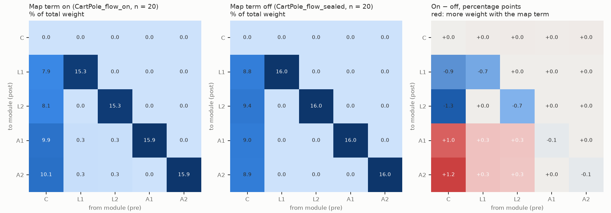
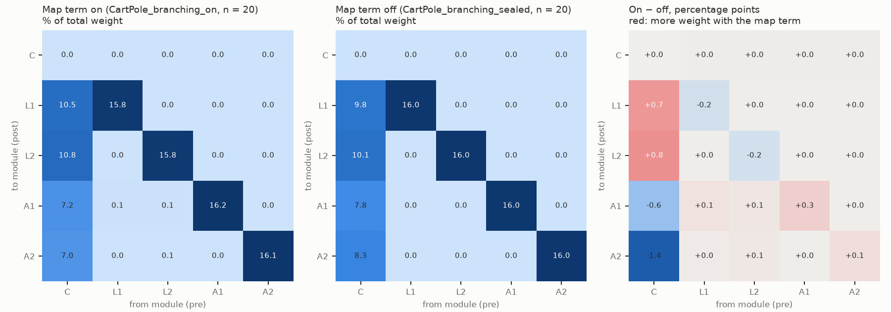
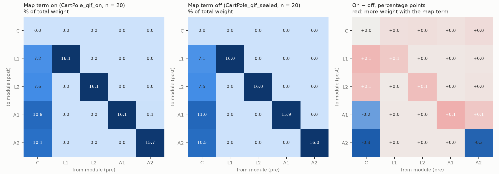
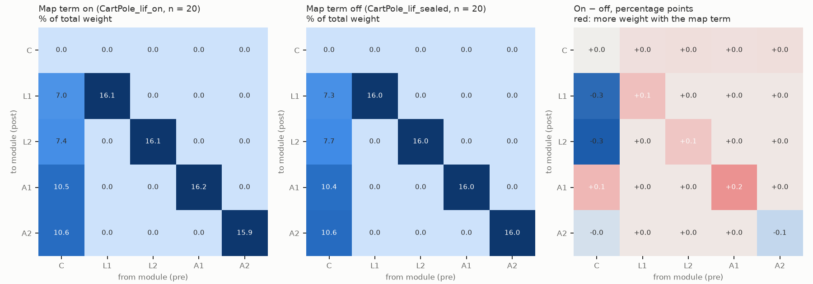

# emergent-v4: network structure

Generated by `python -m experiments.structure` from the saved models only. L_W = map equation (bits) of the trained W's own walk under uniform teleportation (engine-free); block columns = share of the total weight (within modules; C→A, C→L routing; A↔A, A↔L, L↔L across modules; into the controller). Final snapshot, mean ± sd over seeds.

| Group | n | L_W | within | C->A | C->L | A<->A | A<->L | L<->L | ->C |
| --- | --- | --- | --- | --- | --- | --- | --- | --- | --- |
| `CartPole_branching_off` | 20 | 6.222 ± 0.095 | 0.398 ± 0.022 | 0.083 ± 0.030 | 0.276 ± 0.030 | 0.000 ± 0.000 | 0.081 ± 0.013 | 0.023 ± 0.005 | 0.137 ± 0.019 |
| `CartPole_branching_on` | 20 | 4.307 ± 0.026 | 0.640 ± 0.002 | 0.142 ± 0.012 | 0.213 ± 0.012 | 0.000 ± 0.000 | 0.003 ± 0.002 | 0.000 ± 0.000 | 0.001 ± 0.000 |
| `CartPole_branching_sealed` | 20 | 4.192 ± 0.006 | 0.640 ± 0.000 | 0.161 ± 0.007 | 0.199 ± 0.007 | 0.000 ± 0.000 | 0.000 ± 0.000 | 0.000 ± 0.000 | 0.000 ± 0.000 |
| `CartPole_flow_off` | 20 | 5.936 ± 0.171 | 0.481 ± 0.027 | 0.129 ± 0.014 | 0.231 ± 0.014 | 0.000 ± 0.000 | 0.041 ± 0.017 | 0.023 ± 0.005 | 0.094 ± 0.014 |
| `CartPole_flow_on` | 20 | 4.388 ± 0.011 | 0.625 ± 0.003 | 0.200 ± 0.006 | 0.160 ± 0.006 | 0.000 ± 0.000 | 0.013 ± 0.003 | 0.000 ± 0.000 | 0.001 ± 0.000 |
| `CartPole_flow_sealed` | 20 | 4.191 ± 0.006 | 0.640 ± 0.000 | 0.179 ± 0.013 | 0.181 ± 0.013 | 0.000 ± 0.000 | 0.000 ± 0.000 | 0.000 ± 0.000 | 0.000 ± 0.000 |
| `CartPole_lif_off` | 20 | 6.440 ± 0.080 | 0.400 ± 0.016 | 0.202 ± 0.006 | 0.158 ± 0.006 | 0.006 ± 0.003 | 0.085 ± 0.011 | 0.023 ± 0.004 | 0.126 ± 0.009 |
| `CartPole_lif_on` | 20 | 3.799 ± 0.033 | 0.643 ± 0.000 | 0.211 ± 0.006 | 0.144 ± 0.006 | 0.000 ± 0.000 | 0.001 ± 0.000 | 0.000 ± 0.000 | 0.001 ± 0.000 |
| `CartPole_lif_sealed` | 20 | 4.202 ± 0.004 | 0.640 ± 0.000 | 0.210 ± 0.005 | 0.150 ± 0.005 | 0.000 ± 0.000 | 0.000 ± 0.000 | 0.000 ± 0.000 | 0.000 ± 0.000 |
| `CartPole_qif_off` | 20 | 5.898 ± 0.207 | 0.465 ± 0.019 | 0.256 ± 0.013 | 0.104 ± 0.012 | 0.006 ± 0.004 | 0.062 ± 0.009 | 0.025 ± 0.006 | 0.082 ± 0.015 |
| `CartPole_qif_on` | 20 | 3.570 ± 0.171 | 0.640 ± 0.005 | 0.209 ± 0.023 | 0.148 ± 0.023 | 0.001 ± 0.003 | 0.001 ± 0.000 | 0.000 ± 0.000 | 0.001 ± 0.000 |
| `CartPole_qif_sealed` | 20 | 4.184 ± 0.007 | 0.640 ± 0.000 | 0.214 ± 0.013 | 0.146 ± 0.013 | 0.000 ± 0.000 | 0.000 ± 0.000 | 0.000 ± 0.000 | 0.000 ± 0.000 |

## Pairs (final snapshot)

Two-sided Mann–Whitney p, unadjusted; difference = group − against.

| Group | Against | Metric | Group mean | Against mean | Difference | p |
| --- | --- | --- | --- | --- | --- | --- |
| `CartPole_flow_on` | `CartPole_flow_off` | L_W | 4.388 | 5.936 | -1.548 | 6.8e-08 |
| `CartPole_flow_on` | `CartPole_flow_off` | within | 0.625 | 0.481 | +0.144 | 6.8e-08 |
| `CartPole_flow_on` | `CartPole_flow_off` | C->A | 0.200 | 0.129 | +0.071 | 6.8e-08 |
| `CartPole_flow_on` | `CartPole_flow_off` | C->L | 0.160 | 0.231 | -0.071 | 6.8e-08 |
| `CartPole_flow_on` | `CartPole_flow_off` | A<->A | 0.000 | 0.000 | -0.000 | 3.3e-05 |
| `CartPole_flow_on` | `CartPole_flow_off` | A<->L | 0.013 | 0.041 | -0.028 | 9.1e-07 |
| `CartPole_flow_on` | `CartPole_flow_off` | L<->L | 0.000 | 0.023 | -0.023 | 6.8e-08 |
| `CartPole_flow_on` | `CartPole_flow_off` | ->C | 0.001 | 0.094 | -0.093 | 6.8e-08 |
| `CartPole_flow_on` | `CartPole_flow_sealed` | L_W | 4.388 | 4.191 | +0.197 | 6.8e-08 |
| `CartPole_flow_on` | `CartPole_flow_sealed` | within | 0.625 | 0.640 | -0.015 | 6.8e-08 |
| `CartPole_flow_on` | `CartPole_flow_sealed` | C->A | 0.200 | 0.179 | +0.021 | 7.9e-07 |
| `CartPole_flow_on` | `CartPole_flow_sealed` | C->L | 0.160 | 0.181 | -0.021 | 6.9e-07 |
| `CartPole_flow_on` | `CartPole_flow_sealed` | A<->A | 0.000 | 0.000 | +0.000 | 8e-09 |
| `CartPole_flow_on` | `CartPole_flow_sealed` | A<->L | 0.013 | 0.000 | +0.013 | 8e-09 |
| `CartPole_flow_on` | `CartPole_flow_sealed` | L<->L | 0.000 | 0.000 | +0.000 | 8e-09 |
| `CartPole_flow_on` | `CartPole_flow_sealed` | ->C | 0.001 | 0.000 | +0.001 | 8e-09 |
| `CartPole_branching_on` | `CartPole_branching_off` | L_W | 4.307 | 6.222 | -1.915 | 6.8e-08 |
| `CartPole_branching_on` | `CartPole_branching_off` | within | 0.640 | 0.398 | +0.242 | 6.8e-08 |
| `CartPole_branching_on` | `CartPole_branching_off` | C->A | 0.142 | 0.083 | +0.058 | 5.2e-07 |
| `CartPole_branching_on` | `CartPole_branching_off` | C->L | 0.213 | 0.276 | -0.063 | 3e-07 |
| `CartPole_branching_on` | `CartPole_branching_off` | A<->A | 0.000 | 0.000 | -0.000 | 0.00013 |
| `CartPole_branching_on` | `CartPole_branching_off` | A<->L | 0.003 | 0.081 | -0.078 | 6.8e-08 |
| `CartPole_branching_on` | `CartPole_branching_off` | L<->L | 0.000 | 0.023 | -0.023 | 6.8e-08 |
| `CartPole_branching_on` | `CartPole_branching_off` | ->C | 0.001 | 0.137 | -0.136 | 6.8e-08 |
| `CartPole_branching_on` | `CartPole_branching_sealed` | L_W | 4.307 | 4.192 | +0.115 | 6.8e-08 |
| `CartPole_branching_on` | `CartPole_branching_sealed` | within | 0.640 | 0.640 | +0.000 | 0.69 |
| `CartPole_branching_on` | `CartPole_branching_sealed` | C->A | 0.142 | 0.161 | -0.019 | 8.6e-06 |
| `CartPole_branching_on` | `CartPole_branching_sealed` | C->L | 0.213 | 0.199 | +0.014 | 6.6e-05 |
| `CartPole_branching_on` | `CartPole_branching_sealed` | A<->A | 0.000 | 0.000 | +0.000 | 8e-09 |
| `CartPole_branching_on` | `CartPole_branching_sealed` | A<->L | 0.003 | 0.000 | +0.003 | 8e-09 |
| `CartPole_branching_on` | `CartPole_branching_sealed` | L<->L | 0.000 | 0.000 | +0.000 | 8e-09 |
| `CartPole_branching_on` | `CartPole_branching_sealed` | ->C | 0.001 | 0.000 | +0.001 | 8e-09 |
| `CartPole_qif_on` | `CartPole_qif_off` | L_W | 3.570 | 5.898 | -2.328 | 6.8e-08 |
| `CartPole_qif_on` | `CartPole_qif_off` | within | 0.640 | 0.465 | +0.174 | 6.8e-08 |
| `CartPole_qif_on` | `CartPole_qif_off` | C->A | 0.209 | 0.256 | -0.047 | 9.2e-08 |
| `CartPole_qif_on` | `CartPole_qif_off` | C->L | 0.148 | 0.104 | +0.044 | 1.7e-07 |
| `CartPole_qif_on` | `CartPole_qif_off` | A<->A | 0.001 | 0.006 | -0.005 | 1e-06 |
| `CartPole_qif_on` | `CartPole_qif_off` | A<->L | 0.001 | 0.062 | -0.061 | 6.8e-08 |
| `CartPole_qif_on` | `CartPole_qif_off` | L<->L | 0.000 | 0.025 | -0.025 | 6.8e-08 |
| `CartPole_qif_on` | `CartPole_qif_off` | ->C | 0.001 | 0.082 | -0.080 | 6.8e-08 |
| `CartPole_qif_on` | `CartPole_qif_sealed` | L_W | 3.570 | 4.184 | -0.614 | 6.8e-08 |
| `CartPole_qif_on` | `CartPole_qif_sealed` | within | 0.640 | 0.640 | -0.000 | 0.0016 |
| `CartPole_qif_on` | `CartPole_qif_sealed` | C->A | 0.209 | 0.214 | -0.005 | 0.8 |
| `CartPole_qif_on` | `CartPole_qif_sealed` | C->L | 0.148 | 0.146 | +0.002 | 0.84 |
| `CartPole_qif_on` | `CartPole_qif_sealed` | A<->A | 0.001 | 0.000 | +0.001 | 8e-09 |
| `CartPole_qif_on` | `CartPole_qif_sealed` | A<->L | 0.001 | 0.000 | +0.001 | 8e-09 |
| `CartPole_qif_on` | `CartPole_qif_sealed` | L<->L | 0.000 | 0.000 | +0.000 | 8e-09 |
| `CartPole_qif_on` | `CartPole_qif_sealed` | ->C | 0.001 | 0.000 | +0.001 | 8e-09 |
| `CartPole_lif_on` | `CartPole_lif_off` | L_W | 3.799 | 6.440 | -2.641 | 6.8e-08 |
| `CartPole_lif_on` | `CartPole_lif_off` | within | 0.643 | 0.400 | +0.242 | 6.8e-08 |
| `CartPole_lif_on` | `CartPole_lif_off` | C->A | 0.211 | 0.202 | +0.009 | 0.0001 |
| `CartPole_lif_on` | `CartPole_lif_off` | C->L | 0.144 | 0.158 | -0.014 | 1.6e-06 |
| `CartPole_lif_on` | `CartPole_lif_off` | A<->A | 0.000 | 0.006 | -0.006 | 6.8e-08 |
| `CartPole_lif_on` | `CartPole_lif_off` | A<->L | 0.001 | 0.085 | -0.084 | 6.8e-08 |
| `CartPole_lif_on` | `CartPole_lif_off` | L<->L | 0.000 | 0.023 | -0.022 | 6.8e-08 |
| `CartPole_lif_on` | `CartPole_lif_off` | ->C | 0.001 | 0.126 | -0.125 | 6.8e-08 |
| `CartPole_lif_on` | `CartPole_lif_sealed` | L_W | 3.799 | 4.202 | -0.403 | 6.8e-08 |
| `CartPole_lif_on` | `CartPole_lif_sealed` | within | 0.643 | 0.640 | +0.003 | 6.8e-08 |
| `CartPole_lif_on` | `CartPole_lif_sealed` | C->A | 0.211 | 0.210 | +0.001 | 0.62 |
| `CartPole_lif_on` | `CartPole_lif_sealed` | C->L | 0.144 | 0.150 | -0.006 | 0.0031 |
| `CartPole_lif_on` | `CartPole_lif_sealed` | A<->A | 0.000 | 0.000 | +0.000 | 8e-09 |
| `CartPole_lif_on` | `CartPole_lif_sealed` | A<->L | 0.001 | 0.000 | +0.001 | 8e-09 |
| `CartPole_lif_on` | `CartPole_lif_sealed` | L<->L | 0.000 | 0.000 | +0.000 | 8e-09 |
| `CartPole_lif_on` | `CartPole_lif_sealed` | ->C | 0.001 | 0.000 | +0.001 | 8e-09 |

